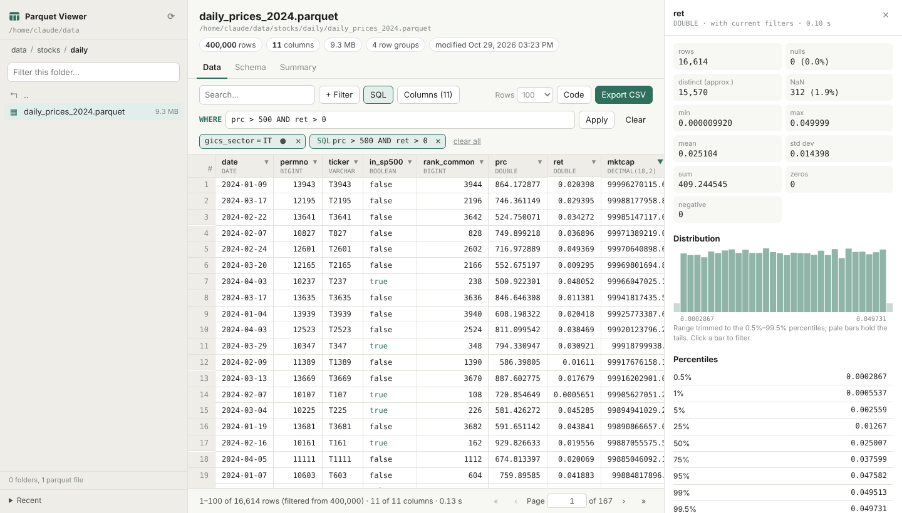
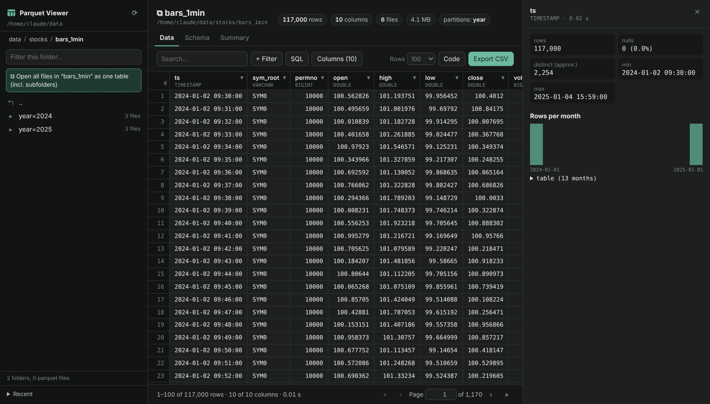

# Parquet Viewer

Look inside a folder full of parquet files from your web browser — no Jupyter, no IPython, no
desktop app. Point it at a folder, click through the sub-folders, open a file (or a whole folder
of files as one table) and sort, search, filter and profile it.

```bash
pip install git+https://github.com/abhandari73/parquet-viewer
pqv ~/data
```



Everything runs on your own computer: a tiny Python web server (standard library only) serves
the page, and [DuckDB](https://duckdb.org) reads the parquet files. Only the rows on screen are
read, so multi-GB files open instantly. The only dependency is `duckdb`; the page uses no CDN, so
it also works offline.

## Features

**Folder browser**
- Breadcrumbs, a filter box, file sizes and counts; only parquet files and folders are listed.
- **Open all files in a folder as one table** — for monthly/daily files or Hive-partitioned data
  (`year=2024/month=01/…`). Every `*.parquet` file below the folder is read together, columns are
  matched by name, `key=value` folder names become columns, and a `_file` column tells you which
  file each row came from.
- Recent files and folders.

**Data**
- Paged grid (50–1,000 rows per page) with the column types in the header.
- **Sort** by clicking a header (asc → desc → off); Shift+click sorts by several columns.
- **Search** across columns: text contains the term, numbers equal it, dates start with it (`2024-06`).
- **Filters** per column: `= ≠ < ≤ > ≥`, between, in / not in, contains, starts / ends with, regex,
  is null, is NaN. Filters show as chips you can edit, switch off or remove.
- **SQL condition** for anything else, e.g. `price > 100 AND country IN ('JP','KR')` or
  `abs(ret) > 0.2 AND date >= '2024-01-01'` (any DuckDB expression).
- **Column picker** with search — handy for files with hundreds of columns.
- **Row detail** panel with every field of a row, a field search and ↑/↓ navigation; ⊕ filters on a value.
- **Column statistics**: nulls, NaN, distinct, min/max/mean/std/sum, percentiles, a histogram
  (trimmed to the 0.5–99.5 % range so outliers don't flatten it), rows per day/month/year for dates,
  most frequent values. Click a bar or a value to filter. Statistics follow the current filters.
- **Export CSV** of the filtered rows and visible columns (the whole result, not just the page).
- **Code**: the DuckDB SQL and a pandas snippet that reproduce the current view.
- The address bar holds the whole view (file, filters, sort, page), so you can bookmark or share it.

**Schema** — DuckDB and parquet types, compression, compressed/uncompressed size and nulls per column;
file metadata (rows, row groups, writer) and key/value metadata such as the pandas or Arrow schema.

**Summary** — min, max, approx. distinct, mean, std, quartiles and null % for all visible columns
(DuckDB `SUMMARIZE`), on demand.

Light and dark mode follow your system.



## Install

Python 3.9 or newer.

```bash
pip install git+https://github.com/abhandari73/parquet-viewer
```

or from a clone:

```bash
git clone https://github.com/abhandari73/parquet-viewer
cd parquet-viewer
pip install .            # or: pip install -e .   while developing
```

Without installing, `pip install duckdb` and run `PYTHONPATH=src python -m parquet_viewer ~/data`.

## Usage

```bash
pqv ~/data                    # opens http://localhost:8770 in your browser
pqv                           # browse the current folder
pqv ~/data --port 9000 --no-browser
```

| Option | Meaning |
|---|---|
| `ROOT` | Folder to browse (default: current folder). Nothing above it can be opened. |
| `--port N` | Port (default 8770). |
| `--no-browser` | Don't open a browser tab. |
| `--memory-limit 2GB` | Cap DuckDB's memory (useful on small machines). |
| `--threads N` | DuckDB threads. |
| `--show-hidden` | Also list hidden files and folders. |
| `--quiet` | Don't log requests. |
| `--host ADDR` | Listen address (default `127.0.0.1`). See Security before changing it. |
| `--version` | Show versions. |

`parquet-viewer` is an alias for `pqv`, and `python -m parquet_viewer` works too.

### Files on another machine

Run the viewer on the remote machine and tunnel the port over SSH; the data never leaves that machine:

```bash
ssh -L 8770:localhost:8770 user@server 'pqv /path/to/data --no-browser --memory-limit 1GB'
# then open http://localhost:8770 locally
```

## Security

- Listens on `127.0.0.1` and only answers requests addressed to `localhost`, so other machines and
  DNS-rebinding tricks can't reach it.
- API calls need a custom header, so other web sites open in your browser can't call it.
- Only files below `ROOT` can be opened. DuckDB itself is locked to that folder
  (`allowed_directories`, `enable_external_access = false`, configuration locked), so the SQL box
  can't read or write files elsewhere, and only a single `SELECT` statement is ever run.
- With `--host 0.0.0.0` anyone who can reach the port can read every file under `ROOT`.

## How it compares

| | This tool | [DuckDB UI](https://duckdb.org/docs/stable/core_extensions/ui) | Drag-and-drop web viewers | Desktop / terminal viewers |
|---|---|---|---|---|
| Browse a folder tree | ✓ | – (write SQL) | – (one file at a time) | some |
| Folder of files as one table | ✓ | via SQL | – | rarely |
| Click-to-filter, column stats | ✓ | partly | partly | varies |
| Files larger than RAM | ✓ (DuckDB streams) | ✓ | limited by browser memory | varies |
| Works offline | ✓ | – (UI loads from ui.duckdb.org) | ✓ | ✓ |
| Install | `pip install` | DuckDB CLI | none | app install |

If you mainly write SQL, the DuckDB UI is great. This tool is for quickly looking around a folder of
data files and slicing them without writing code.

## Notes

- Integers beyond ±2^53 (JavaScript's exact range) are shown as text so they stay exact.
- Timestamps with a time zone are shown as text.
- Floats in the grid are shortened to about 6 significant decimals; the row panel shows full precision.
- Opening a folder with thousands of files works, but the first count or sort reads every file.

## Development

```bash
pip install -e .
python tests/test_parquet_viewer.py      # or: pytest
```

The server is `src/parquet_viewer/server.py`; the front end is plain HTML/CSS/JavaScript in
`src/parquet_viewer/static/` with no build step.

## License

MIT
